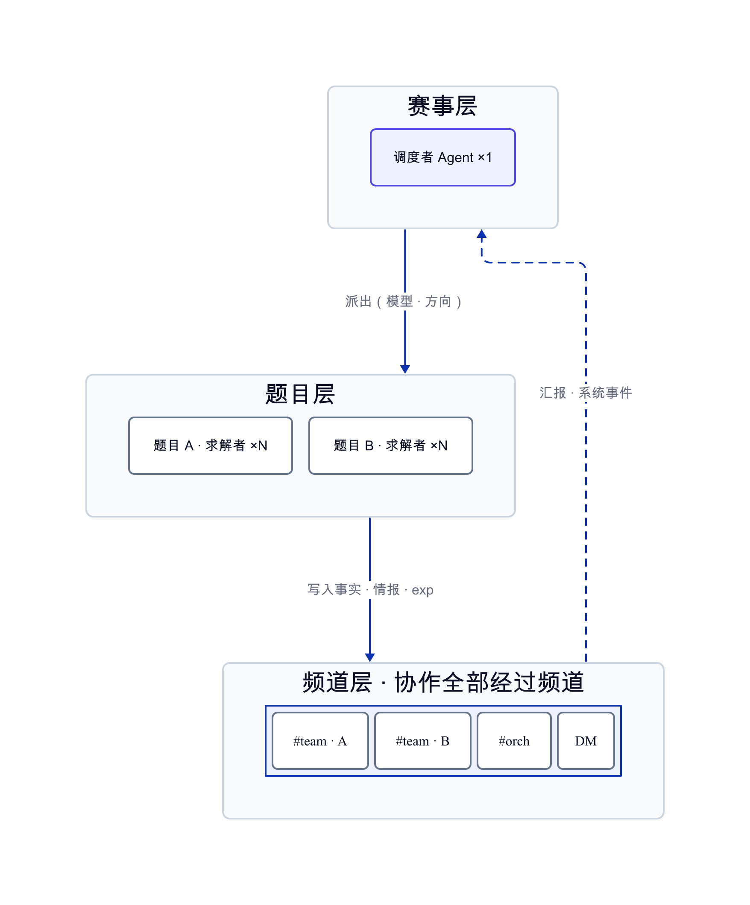
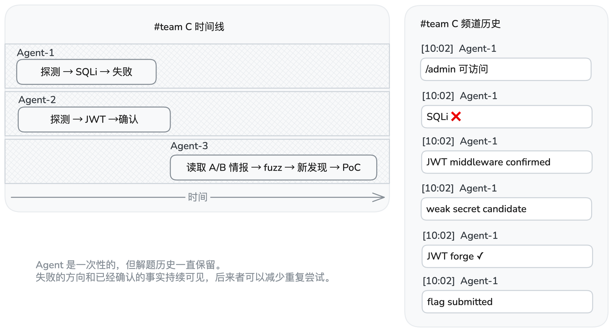
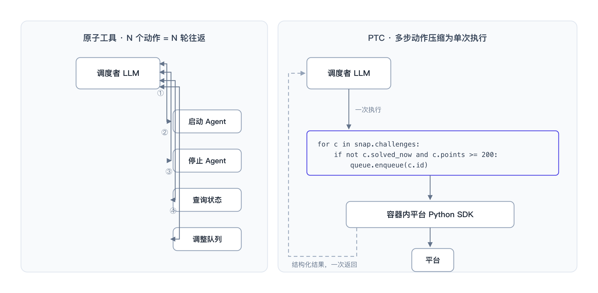
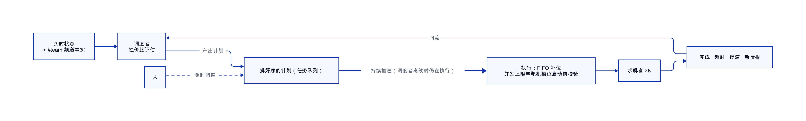
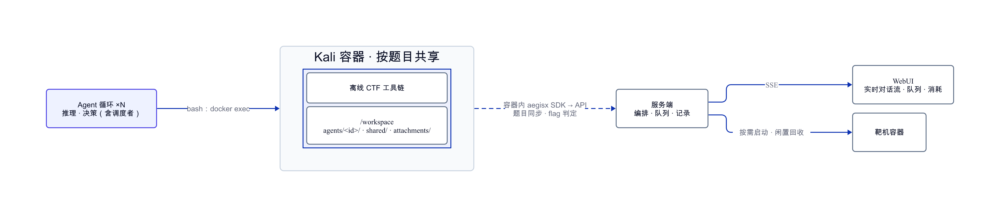
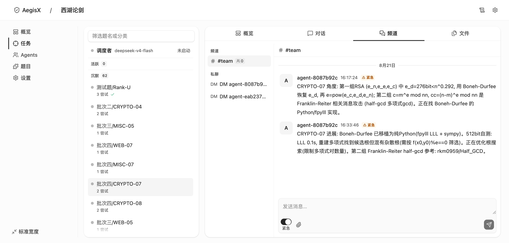

# AegisX 玄甲：多智能体协作的 CTF 解题平台

具备自主决策能力的通用网络安全智能体。

传统 Agent 任务与 CTF/渗透场景的差异在于任务空间与执行路径的不确定性。传统场景有固定目标与可编排的流程，Agent 可以围绕一个明确的方向维护任务清单并逐步收敛；而一道 CTF 题目在开始时往往没有可辨认的方向，需要多方向地试探、排除与回溯，最终利用通常是分阶段展开的。代码审计尚有较固定的方法论可循，而 CTF 则是完全动态的路径。

这意味着以可预测路径和固定范式为前提的 Agent 架构在网络安全场景中并不适用。基于这一判断，AegisX 采用一种极简的多智能体架构：在赛事层设置一个调度者 Agent，在题目层配置若干求解者 Agent，以支持解题过程中的动态探索与协作。

下面从三个问题展开：在一个高度不确定的解题过程中，成绩究竟由什么决定；我们如何组织 Agent 协作；以及为什么题目级事实沉淀和程序化工具调用成为整个系统的关键机制。

## 成绩从哪里来

在一场赛事里拿高分只有两条路径：1. 解出更多的题；2. 更快地解出题。前者取决于解题能力，而解题能力主要来自模型本身；后者取决于调度，也就是围绕题目选择、解题顺序、资源投入与止损时机做连续决策，并在有限的并发、模型预算与靶机配额下进行动态权衡。我们认为解题能力来自模型和驾驭（Harness）工程，而比赛成绩来自调度和基建（Infra）工程。

而对模型，需要有一个清醒的认知：LLM 的单次解题存在相当大的不确定性。同一个模型配上相同的提示词，并不意味着每次尝试都会得到可靠稳定的结果，单次运行本质上仍带有很强的不确定性。我们无法保证一次就解出某道题，但可以做两件事：提高单次命中的概率，或者在命中概率不变的情况下，提高有效尝试的速度。

提高命中率靠的是多样性。面对同一道难题，我们可以派出多个 Agent，混合使用不同的模型、设置不同的初始方向，让每次尝试探索不同的路径。单次尝试的成功概率有限，但当这些尝试足够独立且彼此互补时，联合命中率就会随之上升。与此同时，多样性只有在尝试之间保持有效区分时才有价值；否则，多个 Agent 只是并行重复相同的工作。因此，如何共享已获得的信息、减少路径重叠并推动后续探索，正是后文协作机制要解决的问题。

## Less is more

同类多 Agent 系统的复杂度，往往集中在四个地方：用图状结构组织编排与情报，用文件系统承载协作，预定义一批专家 Agent 并为其编写方法论，以及围绕这些机制搭建多层协作架构。它们背后其实是同一种思路：在系统运行之前，先把协作方式建模出来。什么算一条事实、有哪些角色、谁在什么时候做什么，都需要预先定义。

但这套思路隐含了一个前提：解题路径是足够可预测的。而 CTF 恰恰不是这样。既然我们无法提前知道哪条路径有效，就没有必要先为所有可能的路径设计一套固定的协作结构。

所以，AegisX 没有采用这些预先建模的协作机制，而是把协作关系压缩成一个足够简单的三层结构：一个赛事对应一个调度者 Agent，每道题对应若干求解者 Agent。我们不预先规定 Agent 应该扮演什么专家角色，也不规定它们必须沿什么流程协作；方向在派出时确定，新的信息在题目频道中沉淀，后续 Agent 再基于这些信息接力探索。我们不是把协作流程设计得更完整，而是尽可能少设计，让真正需要的协作结构在解题过程中自然产生。



减法之所以成立，是因为我们删掉的不是能力，而是多余的系统抽象。事实图与状态图承担的知识沉淀与路线判断，交给 IM 协作频道用自然语言完成；文件协作由频道消息与只读共享目录承担；调度能力不拆成一组原子工具，而是直接提供系统级 Python SDK，让 Agent 用代码完成查询、判断、循环和派发。我们尽量不为 Agent 发明新的协作方式，而是把能力建立在它本来就擅长的两种接口上。系统里真正的协作机制只有两个，一个建立在自然语言上，一个建立在代码上，接下来的两节分别展开。

## #team：挂在题目上的事实沉淀

Agent 之间真正需要共享的，不只是某几个结构化事实，而是一场题目的共同解题历史：哪些方向已经尝试过、哪些假设已经被证伪、哪些信息刚刚被确认，以及下一步值得往哪里走。这些信息会随着不同 Agent 的并行探索持续产生，而且必须跨越单次 Agent 的生命周期被保留下来，让后来者能够在同一份上下文上继续工作。换句话说，这里需要的不是一套静态的知识库，而是一条随解题过程不断增长、对同题 Agent 可见的协作时间线。事实图或状态图需要预先定义节点、关系和写入规则，难以自然承载这种开放式、持续变化的解题过程；共享文件虽然足够自由，却缺少天然的消息广播与时间线，Agent 还需要自己决定写什么、读什么、什么时候读。

所以我们没有再设计一套专门的知识协作系统，而是受钉钉、飞书、Discord 等成熟团队协作工具的启发，直接把即时通讯系统（IM）作为 Agent 的协作层。每道题对应一个 #team 频道，同题的求解者把情报、探测结果、已确认与已证伪的判断以及 exp/poc 持续写入其中；频道本身就是这道题的公共解题上下文。调度者与求解者之间则保留两种不同的通信方式：#orch 频道用于汇聚汇报和系统事件，如超时、停滞与 flag 被接受；点对点 DM 用于具体任务的指派和运行中的介入。这样，广播的信息进入题目的共同历史，定向的决策与干预则通过独立通道完成。

在每道题的解题生命周期中，#team 都是持久化的。我们把 Agent 的生命周期与题目的解题上下文彻底解耦。Agent 是一次性的，而解题历史不是。一次尝试可以结束，但它发现的事实、验证过的方向和留下的线索，都应该成为下一次尝试的起点。



这也回答了前面提出的三个问题：所有 Agent 都能从同一份题目历史中获取信息；失败的方向和已经确认的事实会被记录下来，后来者不必重复尝试；调度者则根据这些记录决定下一步探索什么。

## Codemode：把编排交给代码

调度者要做的事情有相当强的程序性：盘点题目与求解者状态，比较若干候选动作，然后把决策落成对队列的操作，再根据执行结果调整下一步。这类工作需要循环、条件与批量操作。而现有的多 Agent 系统通常把调度能力做成一组原子工具，启动一个 Agent、停止一个 Agent、查询状态、调整队列，每个动作都要经过一轮完整的工具调用往返，编排 N 个动作就是 N 轮往返，中间状态全部占用上下文，循环与条件在这样的接口下根本无法表达。

我们的做法不同。调度者的容器里内置了完整的平台 Python SDK，它通过写一个脚本来完成管理动作，这就是程序化工具调用（Programmatic Tool Calling，PTC）。多步调用被压缩成单次执行，返回的是类型安全的结构化数据，token 开销远低于逐工具的往返；而表达能力上的差别是根本性的，循环、条件、重试策略这些复杂的状态控制，在代码里是天然且直接的。



一段典型的调度脚本是这样的：

```python
import aegisx
snap = aegisx.snapshot()
for c in snap.challenges:
    if not c.solved_now and c.points >= 200:
        aegisx.queue.enqueue(c.id, prompt="优先考虑堆利用方向")
```

盘点、决策、入队在一次执行里完成。我们相信 PTC 是 Agent 工具形态的未来趋势：当模型具备可靠的代码能力之后，通过代码所能表达的编排空间和复杂度远大于一组原子工具。

## 调度者：经营一场赛事

SDK 解决了调度者怎么操作的问题，剩下的就是决策本身。调度者不参与解题，它的输入是所有 Agent 的实时状态，以及 #team 频道里沉淀的事实与协作历史；它的产出就是前文定义的那类连续决策：选择哪些题、按什么顺序投入、派多少 Agent、用什么模型，以及何时止损。



我们实现了一套参数化的调度策略，由性价比规则约束决策空间，同时把具体决策交给调度者自主完成。核心是两项指标：解题性价比，即解出题目获得的分数除以这道题已经消耗的时间与 token 费用；LLM 性价比，即解题能力、单价与生成速度三者的综合权衡。具体的选择规则是朴素的：优先把算力投向高性价比的题目与模型，同时综合考虑题目的历史投入、当前进展与预期收益，动态判断下一笔投入是否值得。

## 工程底座

解题镜像是工程底座里与解题能力最相关的一环。我们准备了一套完整的 full 镜像，包含常规 CTF /渗透解题所需的大部分工具与知识库，为离线准备好；同时提供 essential、minimal 等不同尺寸的镜像，以适配不同的资源与使用场景。容器内还附带完整的环境说明文档，工具清单、用法与注意事项都已经写入其中。这样 Agent 无需把有限的 token 和注意力消耗在配环境或找工具上，可以从第一轮就直接进入解题。一套趁手的环境对于 Agent 解题能力和速度是至关重要的。



求解者 Agent 与解题环境相互解耦：Agent 负责推理与决策，shell 命令和 CTF 工具链在独立的 Kali 容器中执行，同一道题的求解者共享同一环境。具体的执行架构如图所示。

AegisX 通过插件化接口适配不同赛事平台，内置 CTFd、A1CTF、DASCTF、Ret2Shell、TSecBench 五类常见平台，题目同步、flag 远程判定、靶机启动与续期等能力均已接入。

多 Agent 系统一旦进入实际使用，WebUI 就不再只是一个展示层，而是整个系统的操作面。AegisX 提供实时对话流、题目总览与队列编辑、Agent 关系图、全局活动日志和 IM 频道视图，并将 token 消耗、费用与缓存命中率贯穿到整个观测链路。



工程上采用现代化的 monorepo 架构，服务端、前端和共享类型统一管理，wire 类型端到端贯通，Python SDK 通过契约测试保证接口一致性。它不直接决定解题能力，但让调度、执行、观测和 WebUI 能在同一套工程体系下快速迭代。

## 实战成绩

（本节内容待补：参赛赛事、名次与解题数据。）

## 结语

回到开头的判断：解题能力来自模型和驾驭工程，比赛成绩来自调度和基建工程。模型不归我们做，其余三件 AegisX 各有一套完整答案：驾驭靠离线镜像与题目级的事实沉淀，调度靠性价比策略与队列，基建靠平台适配、可观测性与人的界面。

同类系统在教 Agent 解题，而我们在教一支 Agent 团队工作。
