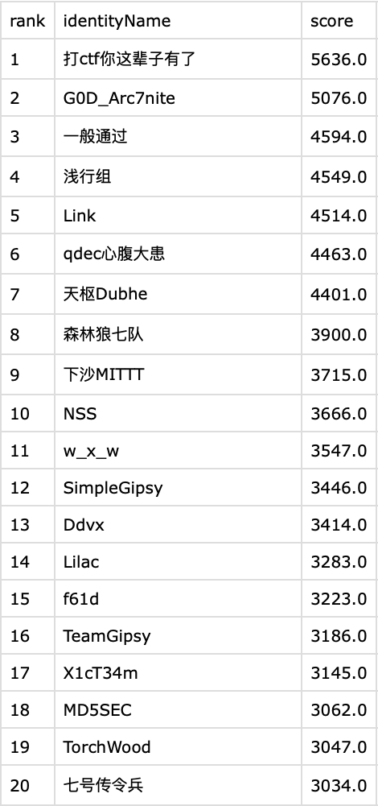

# AegisX 玄甲：多智能体协作的 CTF 解题平台

具备自主决策能力的通用网络安全智能体。

传统 Agent 任务与 CTF/渗透场景的差异，在于任务空间与执行路径的不确定性。传统任务通常有明确目标与可编排的流程，Agent 可以围绕一个方向维护任务清单并逐步收敛；而一道 CTF 题目开始时往往没有明确方向，需要不断试探、排除和回溯，最终利用也通常是分阶段展开的。代码审计尚有相对稳定的方法论可循，而 CTF 的有效路径往往要在过程中发现。

这意味着以可预测路径和固定范式为前提的 Agent 架构在网络安全场景中并不适用。基于这一判断，AegisX 采用一种极简的多智能体架构：在赛事层设置一个调度者 Agent，在题目层配置若干求解者 Agent，以支持解题过程中的动态探索与协作。

下面从三个问题展开：在一个高度不确定的解题过程中，成绩究竟由什么决定；我们如何组织 Agent 协作；以及为什么题目级事实沉淀和程序化工具调用成为整个系统的关键机制。

## 成绩从哪里来

在一场赛事里拿高分只有两条路径：解出更多的题，或者更快地解出题。前者取决于解题能力，后者取决于调度：围绕题目选择、解题顺序、资源投入与止损时机做连续决策，并在有限的并发、模型预算与靶机配额下动态权衡。我们把前者归因于模型与驾驭（Harness）工程，把后者归因于调度与基建（Infra）工程。

而对模型，需要有一个清醒的认知：LLM 的单次解题存在相当大的不确定性。同一个模型配上相同的提示词，并不意味着每次尝试都会得到可靠稳定的结果，单次运行本质上仍带有很强的不确定性。我们无法保证一次就解出某道题，但可以做两件事：提高单次命中的概率，或者在命中概率不变的情况下，提高有效尝试的速度。

提高命中率靠的是多样性。面对同一道难题，我们可以派出多个 Agent，混合使用不同的模型、设置不同的初始方向，让不同尝试探索不同的路径。单次尝试的成功概率有限，但当这些尝试足够独立且彼此互补时，联合命中率就会随之上升。与此同时，多样性只有在尝试之间保持有效区分时才有价值；否则，多个 Agent 只是并行重复相同的工作。因此，如何共享已获得的信息、减少路径重叠并推动后续探索，正是后文协作机制要解决的问题。

## Less is more

同类多 Agent 系统的复杂度，往往集中在四个地方：用图状结构组织编排与情报，用文件系统承载协作，预定义一批专家 Agent 并为其编写方法论，以及围绕这些机制搭建多层协作架构。它们背后其实是同一种思路：在系统运行之前，先把协作方式建模出来。什么算一条事实、有哪些角色、谁在什么时候做什么，都需要预先定义。

但这套思路隐含了一个前提：解题路径是足够可预测的。而 CTF 恰恰不是这样。既然我们无法提前知道哪条路径有效，就没有必要先为所有可能的路径设计一套固定的协作结构。

所以，AegisX 没有采用这些预先建模的协作机制，而是把协作关系压缩成一个足够简单的三层结构：一个赛事对应一个调度者 Agent，每道题对应若干求解者 Agent。我们不预先规定 Agent 应该扮演什么专家角色，也不规定它们必须沿什么流程协作；方向在派出时确定，新的信息在题目频道中沉淀，后续 Agent 再基于这些信息接力探索。我们不是把协作流程设计得更完整，而是尽可能少设计，让真正需要的协作结构在解题过程中自然产生。


减法之所以成立，是因为我们删掉的不是能力，而是多余的系统抽象。事实沉淀和协作路线判断交给 IM 频道用自然语言完成；文件协作由频道消息与共享目录承担；调度能力不拆成一组原子工具，而是直接提供平台 Python SDK，让 Agent 用代码完成查询、判断、循环和派发。我们尽量不为 Agent 发明新的协作方式，而是把能力建立在它本来就擅长的两种接口上：自然语言和代码。接下来的两节分别展开。

## #team：挂在题目上的事实沉淀

Agent 之间真正需要共享的，不只是某几个结构化事实，而是一场题目的共同解题历史：哪些方向已经尝试过、哪些假设已经被证伪、哪些信息刚刚被确认，以及下一步值得往哪里走。这些信息会随着不同 Agent 的并行探索持续产生，而且必须跨越单次 Agent 的生命周期被保留下来，让后来者能够在同一份上下文上继续工作。换句话说，这里需要的不是一套静态的知识库，而是一条随解题过程不断增长、对同题 Agent 可见的协作时间线。事实图或状态图需要预先定义节点、关系和写入规则，难以自然承载这种开放式、持续变化的解题过程；共享文件虽然足够自由，却缺少天然的消息广播与时间线，Agent 还需要自己决定写什么、读什么、什么时候读。

所以我们没有再设计一套专门的知识协作系统，而是借鉴钉钉、飞书、Discord 等成熟团队协作工具的模式，直接把即时通讯系统（IM）作为 Agent 的协作层。每道题对应一个 #team 频道，同题的求解者把情报、探测结果、已确认与已证伪的判断以及 exp/poc 持续写入其中；频道本身就是这道题的公共解题上下文。调度者与求解者之间则保留两种不同的通信方式：#orch 频道用于汇聚汇报和系统事件，如超时、停滞与 flag 被接受；点对点 DM 用于具体任务的指派和运行中的介入。这样，广播的信息进入题目的共同历史，具体的任务指派与运行中的干预则通过独立通道完成。

在每道题的解题生命周期中，#team 都是持久化的。我们把 Agent 的生命周期与题目的解题上下文彻底解耦。Agent 是一次性的，而解题历史不是。一次尝试可以结束，但它发现的事实、验证过的方向和留下的线索，都应该成为下一次尝试的起点。


这也回答了前面提出的三个问题：所有 Agent 都能从同一份题目历史中获取信息；失败的方向和已经确认的事实持续可见，后来者可以减少重复尝试；调度者则基于这些记录决定下一步探索什么。

## Codemode：把编排交给代码

调度者要做的事情有很强的程序性：盘点题目与求解者状态，比较候选动作，把决策落成队列操作，再根据执行结果调整下一步。这类工作天然需要循环、条件与批量操作。而现有的多 Agent 系统通常把调度能力做成一组原子工具：启动 Agent、停止 Agent、查询状态、调整队列。每个动作都要经过一轮工具调用往返，编排 N 个动作就需要 N 轮往返，中间状态也全部进入上下文，复杂的循环与条件很难表达。

我们的做法不同。调度者的容器里内置了完整的平台 Python SDK，它通过编写脚本一次完成一组管理动作，这就是程序化工具调用（Programmatic Tool Calling，PTC）。多步调用被压缩成单次执行，返回的是类型安全的结构化数据，token 开销远低于逐工具的往返；而表达能力上的差别是根本性的，循环、条件、重试策略等复杂的状态控制，在代码里都是天然且直接的。


一段典型的调度脚本是这样的：

```python
import aegisx
snap = aegisx.snapshot()
for c in snap.challenges:
    if not c.solved_now and c.points >= 200:
        aegisx.queue.enqueue(c.id, prompt="优先考虑堆利用方向")
```

盘点、决策、入队在一次执行里完成。我们相信 PTC 是 Agent 工具形态的未来趋势：当模型具备可靠的代码能力之后，通过代码所能表达的编排空间和复杂度远大于一组原子工具。

## 调度者：经营一场赛事

SDK 解决了调度者怎么操作的问题，剩下的就是决策本身。调度者不参与解题，它的输入是所有 Agent 的实时状态，以及 #team 频道里沉淀的事实与协作历史；它的产出就是前文定义的那类连续决策：选择哪些题、按什么顺序投入、派多少 Agent、用什么模型，以及何时止损。


我们实现了一套参数化的调度框架，由性价比规则定义决策标准，同时把具体资源分配交给调度者自主完成。核心是两项指标：解题性价比，即题目得分与已消耗时间、token 费用之间的比值；LLM 性价比，即解题能力、单价与生成速度三者的综合权衡。具体的选择规则是朴素的：优先把算力投向高性价比的题目与模型，同时综合考虑题目的历史投入、当前进展与预期收益，动态判断下一笔投入是否值得。

决策如何落地同样重要。赛事中的事件持续发生：求解者完成、超时、停滞、新情报写入。如果每一件事都要实时唤醒调度者现场决策，调度者的一轮推理需要时间，两轮决策之间就会留下空窗期，并发额度闲置，比赛时间被白白消耗。

任务队列把调度从即时响应改成了计划驱动。调度者的产出不再是逐条的即时指令，而是一份排好序的计划，队列中的一项就表示「在这道题上派出一个 Agent」；系统按 FIFO 执行计划，腾出并发额度就自动补位，并发上限与靶机槽位在启动前由系统强制校验，不依赖调度者自觉遵守。执行从此不必等待决策：调度者离线时，计划仍在推进。

这份计划同时也是人与调度者共享的工作面：人在界面上看到接下来的安排并可以随时调整，调度者平时只需要接收事件消息，必要时再修订计划。它的注意力与 token 因此更多花在决策上，而不是花在逐条响应事件上。

## 工程底座

解题镜像是工程底座里与解题能力最相关的一环。我们准备了一套完整的 full 镜像，包含常规 CTF/渗透解题所需的大部分工具与知识库，全部离线准备好；同时提供 essential、minimal 等不同尺寸的镜像，以适配不同的资源与使用场景。容器内还附带完整的环境说明文档，工具清单、用法与注意事项都已经写入其中。这样 Agent 无需把有限的 token 和注意力消耗在配环境或找工具上，可以从第一轮就直接进入解题。一套趁手的环境对于 Agent 解题能力和速度是至关重要的。

求解者 Agent 与解题环境相互解耦：Agent 负责推理与决策，shell 命令和 CTF 工具链在独立的 Kali 容器中执行，同一道题的求解者共享同一环境。具体的执行架构如图所示。


AegisX 通过插件化接口适配不同赛事平台，内置 CTFd、A1CTF、DASCTF、Ret2Shell、TSecBench 五类常见平台，题目同步、flag 远程判定、靶机启动与续期等能力均已接入。

并行的代价是可观测性。单个 Agent 的过程只是一条对话流；十个 Agent 并行解题时，谁在解什么、进展到哪里、花掉了多少 token、哪个已经停滞，信息会迅速分散到几十路流里。人看不过来，指挥就无从谈起。

AegisX 的界面按完整产品来构建，覆盖接入平台、配置模型、派出 Agent、调整队列和回溯活动的完整流程，代码量与服务端相当，是项目的半壁江山。而它做对的关键一件事，是让人以与 Agent 相同的方式参与协作：#team 频道对人就是一个普通的聊天视图，人读到的是同一份题目历史；介入一个求解者用的是 DM，与调度者指派任务走的是同一条通道；调度者排好的任务队列直接呈现在界面上。不存在一个独立于协作系统之外的控制台，人就是协作系统的一个参与者。

实时性决定了介入的价值。每个 Agent 的流式输出、工具执行进度、token 消耗与上下文占用都实时推送到界面。一个求解者方向走偏，往往前几轮就能看出来，一条消息就能纠正。指挥发生在过程中，而不是赛后。


工程上采用现代化的 monorepo 架构，服务端、前端、共享类型与 SDK 统一管理，wire 类型端到端贯通，Python SDK 通过契约测试保证接口一致性。它不直接决定解题能力，但让调度、执行、观测和 WebUI 能在同一套工程体系下快速迭代。

## 自进化：内环与外环

以上的机制让 AegisX 能够打好眼前的比赛，而这个系统的另一个属性，是随着使用不断变强。模型本身的权重不归我们训练，但模型之外的一切，镜像、提示词与调度策略，都是可以改进的东西；AegisX 把这种改进组织成两个循环。

内环在一场赛事之内。调度者是贯穿全场的常驻 Agent，每解出一道题，它都会把这道题的做法与教训纳入自己的判断，后续的派发决策与提示词立刻用上这些经验。比赛进行得越久，它对这场赛事的理解就越深。

外环在赛事之间。系统完整记录每一个 Agent 的会话历史、全部系统事件与每一笔时间、费用消耗，可回放、可查询，一场比赛打完，它的全部过程都是可归因的：哪道题卡在哪一步、为什么卡、是工具链的缺口还是提示词的误导，答案都在记录里。复盘的结论最终落在系统本身上：补进镜像的工具、修改的提示词、调整的策略，成为下一场比赛的起点。

内环让一场赛事之内的经验即时复用，外环让一场场赛事之间的积累沉淀为系统本身。对一套不动模型权重的系统来说，这就是它的学习方式。


## 实战成绩

一套系统的成色，最终还是要在真实赛事中检验。在今年八月的西湖论剑赛事中，AegisX 以 5636 分的总分，在 608 支队伍中取得第一名的成绩。



整场比赛总成本仅 19.69 美元，平均每个求解实例不足 0.3 美元，全部调用使用国产模型。账单如下：

| 模型 | 请求数 | 输入 | 输出 | 费用（输入/输出） |
|---|---:|---:|---:|---:|
| deepseek-v4-flash | 3,435（78%） | 215.7M | 3.6M | $0.60 / $3.52（21%） |
| kimi-k3 | 940（22%） | 41.2M | 0.5M | $12.36 / $3.21（79%） |
| 合计 | 4,375 | 256.9M | 4.1M | $19.69 |

这张账单本身就是调度策略的结果。deepseek-v4-flash 承担了 78% 的请求，却只占 21% 的费用；kimi-k3 只占 22% 的请求，却承担 79% 的预算。模型不是全局固定配置，而是由调度者逐题选择：便宜模型承担大量常规尝试，更贵的模型只在值得投入的题目上出现。

另一组数字来自 TSecBench v1 数据集。TSecBench 评测的条件更严格：平台托管、完全无人值守，我们无法在运行过程中介入；全程固定使用 deepseek-v4-flash，最终以几十元人民币的模型成本取得了成绩，而其他 Agent 系统使用进口模型需要花费数千元才能达到相近水平。即便对比其他同样使用 deepseek-v4-flash 模型的 Agent，我们的成绩也有较大竞争力，这正是 AegisX 优秀架构的结果。


当模型和预算都被固定，成绩差异就不再主要来自模型本身，而来自模型之外的系统能力：尝试是否足够多样，失败的信息能否复用，有限的算力能否持续投向更值得的题目。

得分曲线呈对数形态：前期增长陡峭，后期逐渐放缓，得分点在时间轴上分布均匀，直到比赛后段仍持续有得分点出现。


随着题目难度上升，单位时间的得分效率虽然下降，但解题过程仍在持续推进。多样性的尝试让更多路径有机会命中，题目级事实沉淀减少了重复尝试，调度者则不断把有限的预算重新分配到更值得的地方。

两场比赛都全程使用国产模型。我们很高兴看到国产模型能力本身正在快速提升，而在 AegisX 里，模型只是可替换的资源：新的模型不需要改造系统，下一次派发即可投入使用；模型成本越低，可承载的尝试就越多，多样性调度的空间也越大。对一套不动模型权重的系统来说，模型的每一次进步，都会直接成为系统能力的进步。

从真实赛事的结果看，模型预算并不是唯一决定成绩的变量。更重要的是，有限的模型调用能否被正确地分配、复用和持续转化为有效的解题尝试。

少即是多的设计哲学，最终要用比赛里的分数和账单来证明。

## 结语

回到开头的判断：解题能力来自模型和驾驭工程，比赛成绩来自调度和基建工程。模型不归我们做，其余三件 AegisX 各有一套完整答案：驾驭靠离线镜像与题目级的事实沉淀，调度靠性价比策略与队列，基建靠平台适配、可观测性与人的界面。

同类系统在教 Agent 解题，而我们在教一支 Agent 团队工作。
