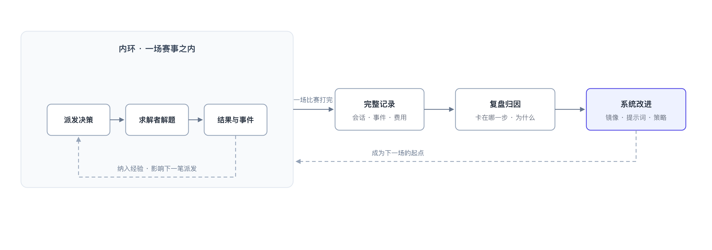
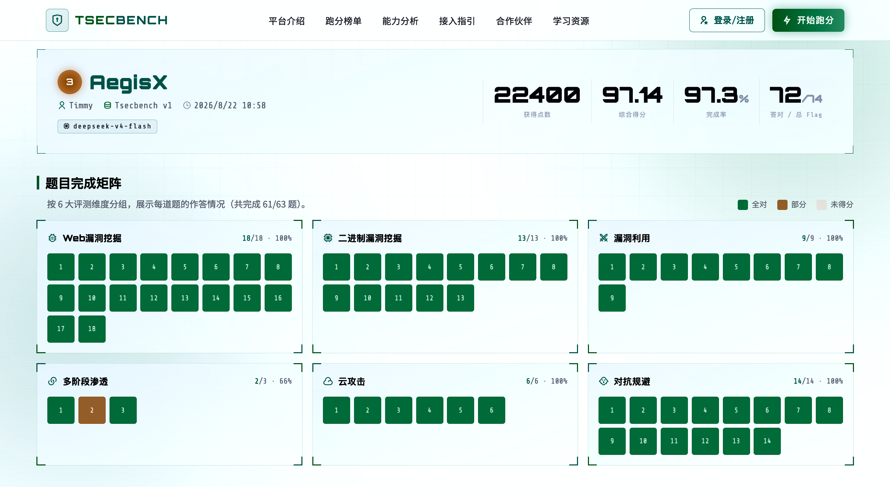
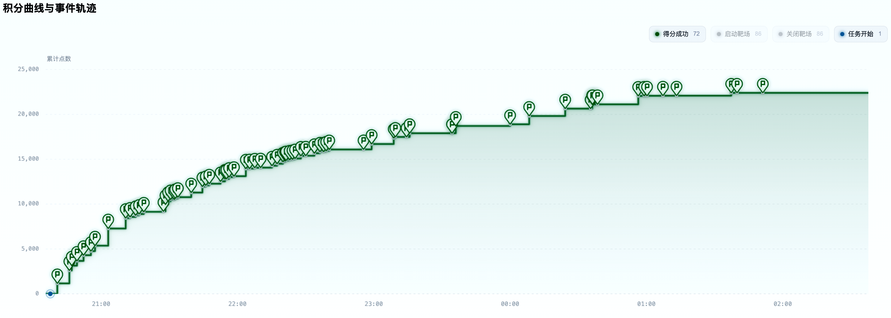

# AegisX 玄甲：网络安全多智能体协作解题平台

传统 Agent 任务与 CTF/渗透场景的差异，在于任务空间与执行路径的不确定性。传统任务通常有明确目标与可编排的流程，Agent 可以围绕一个方向维护任务清单并逐步收敛；而一道 CTF 题目在开始时往往没有明确方向，需要持续试探、排除和回溯，最终利用也通常是分阶段展开的。代码审计尚有相对稳定的方法论可循，而 CTF 的有效路径往往要在探索过程中发现。

这意味着以可预测路径和固定范式为前提的 Agent 架构在网络安全场景中并不适用。基于这一判断，AegisX 采用一种极简的多智能体架构：不预先设计所有协作路径，而是保留最小组织结构，让 Agent 在运行中形成有效的协作。具体实现上，在赛事层设置一个调度者 Agent，在题目层配置若干求解者 Agent；前者负责规划与编排，后者负责解题中的动态探索与协作。

下面围绕三个问题展开：在高度不确定的解题过程中，成绩究竟由什么决定；我们如何组织 Agent 协作，使不同尝试能够真正形成接力；以及为什么题目级事实沉淀、程序化工具调用和计划驱动的调度，构成整个系统的关键机制。

## 把不确定性转化为可优化的投入产出

在一场赛事里取得高分只有两条路径：解出更多的题，或者更快地解出题。前者依赖模型能力与驾驭（Harness）工程，后者则更多依赖调度与基建（Infra）工程。系统需要围绕题目选择、解题顺序、资源投入与止损时机做连续决策，并在有限的并发、模型预算与靶机配额下动态权衡。任何一次错误投入都会占用本可以用于其他题目的机会成本。

而对 LLM 的应用则需要有现实判断：单次执行的解题结果存在显著不确定性。即便模型、提示词与题目完全相同，每次生成亦未必稳定可靠，系统难以保证一次命中。此不确定性的根源在于 Transformer 的自回归解码机制——每步基于概率分布采样下一词，而长序列生成中逐级累积的随机波动易使最终答案产生分歧。对此，改善整体收益可从两方向入手：提高单次尝试的成功概率，或者在命中概率没有明显变化时，提高有效尝试的速度与数量。

提高整体命中率的一个直接办法是增加尝试的多样性。面对同一道难题，可以派出多个 Agent，混合使用不同的模型、设置不同的初始方向，让各次尝试探索不同的路径。单次尝试的成功概率有限，但当这些尝试具有足够区分度且彼此互补时，联合命中率就会随之上升。但多样性只有在尝试之间保持有效区分时才有价值；否则，多个 Agent 只是并行重复相同的工作。因此，如何共享已获得的信息、减少路径重叠并推动后续探索，正是后文协作机制要解决的问题。

## 少即是多的设计哲学

同类多 Agent 系统的复杂度，往往集中在四个地方：用图状结构组织编排与情报，用文件系统承载协作，预定义一批专家 Agent 并为其编写方法论，以及围绕这些机制搭建多层协作架构。它们背后其实是同一种思路：在系统运行之前，先把协作方式建模出来。什么算一条事实、有哪些角色、谁在什么时候做什么，都需要预先定义。

但这套思路隐含了一个前提：解题路径是足够可预测的。而 CTF 恰恰不是这样。既然我们无法提前知道哪条路径有效，就没有必要先为所有可能的路径设计一套固定的协作结构。因此 AegisX 没有采用预先建模的协作机制，而是把协作关系压缩成一个足够简单的结构：一场赛事对应一个调度者 Agent，每道题对应若干求解者 Agent。我们不预先规定 Agent 必须扮演怎样的专家角色，也不要求所有 Agent 沿着同一套固定流程协作；方向在派出时确定，新的信息在题目频道中沉淀，后续 Agent 再基于这些信息接力探索。我们不是把协作流程设计得更完整，而是尽可能少设计，让真正需要的协作结构在解题过程中自然产生。


减法之所以成立，是因为我们删掉的不是能力，而是多余的预先编码的协作语义。事实沉淀与协作路线判断交给 IM 频道用自然语言完成；文件协作由频道消息与共享目录承担；调度能力不被拆成大量原子工具，而是直接提供平台 Python SDK，让 Agent 用代码完成查询、判断、循环和派发。我们尽量不为 Agent 发明新的协作方式，而是把能力建立在它本来就擅长的两种接口上：自然语言和代码。接下来的两节分别展开。

## 让 Agent 接力协作

Agent 之间真正需要共享的，不只是某几个结构化事实，而是一道题目的共同解题历史：哪些方向已经尝试过、哪些假设已经被证伪、哪些信息刚刚被确认，以及接下来哪些方向值得继续投入。这些信息会随着不同 Agent 的并行探索持续产生，而且必须跨越单次 Agent 的生命周期被保留下来，才能让后来的尝试真正站在前一次尝试的肩膀上。换句话说，这里需要的不是一套静态的知识库，而是一条随解题过程不断增长、对同题 Agent 可见的协作时间线。事实图或状态图需要预先定义节点、关系和写入规则，难以自然承载这种开放式、持续演进的求解过程；共享文件虽提供足够的灵活性，却缺乏内建的消息广播与时间轴机制，Agent 仍需自行决策写入内容、读取对象及读取时机。

因此，AegisX 没有再设计一套专门的知识协作系统，而是借鉴钉钉、飞书、Discord 等成熟团队协作工具的模式，直接把即时通讯系统（IM）作为 Agent 的协作层。每道题对应一个 #team 频道，同题的求解者将情报、探测结果、已确认与已证伪的判断以及 Exploit/PoC 持续写入其中；频道本身就是这道题的公共解题上下文。调度者与求解者之间则保留两种不同的通信方式：#orch 频道用于汇聚汇报和系统事件，例如超时、停滞与 flag 被接受；点对点 DM 用于具体任务指派，以及运行中的介入。这样，广播的信息进入题目的共同历史，具体的任务指派与运行中的干预则通过独立通道完成。

在每道题的解题生命周期中，#team 都是持久化的。我们把 Agent 的生命周期与题目的解题上下文彻底解耦。Agent 可以是一次性的，而解题历史不是。一次尝试可以结束，但它发现的事实、验证过的方向和留下的线索，都应当成为下一次尝试的起点。


这也回答了前面提出的三个问题：所有 Agent 都能从同一份题目历史中获取信息；失败的方向和已经确认的事实持续可见，后来者可以减少重复尝试；调度者也能够基于这些记录判断下一步应该把资源投入在哪里。

## 把调度编排交给代码

调度者要做的工作有很强的程序性：盘点题目与求解者状态，比较候选动作，把决策实施为队列操作，再根据执行结果调整下一步。这类工作天然需要循环、条件、批量操作和状态控制。而现有的多 Agent 系统通常把调度能力做成一组原子工具：启动 Agent、停止 Agent、查询状态、调整队列。每个动作都要经过一轮工具调用往返，编排 N 个动作就需要 N 轮往返，中间状态也全部进入上下文，复杂的循环与条件很难表达。

AegisX 的做法不同。调度者容器中内置完整的平台 Python SDK，调度者直接编写脚本，一次执行完成一组管理动作，这就是程序化工具调用（Programmatic Tool Calling，PTC）。多步调用可以被压缩到一次执行，返回结构化、类型安全的结果；更重要的是，循环、条件和重试等状态控制直接由代码表达，而不是拆成大量工具调用。对于需要批量编排与持续状态控制的 Agent 系统，这种接口形态是天然且直接的。


一段典型的调度脚本是这样的：

```python
import aegisx
snap = aegisx.snapshot()
for c in snap.challenges:
    if not c.solved_now and c.points >= 200:
        aegisx.queue.enqueue(c.id, prompt="优先考虑堆利用方向")
```

盘点、决策、入队在一次执行里完成。我们相信 PTC 是 Agent 工具形态的未来趋势：当模型具备可靠的代码能力之后，通过代码所能表达的编排空间和复杂度，远非一组预定义的原子工具可比。但此处的核心并非代码本身，而在于接口边界的设计：系统将平台能力以开放接口的形式提供给 Agent，从而无需为每一种调度策略事先定制固定的动作集合。

## 计划驱动的赛事调度

SDK 解决了调度者怎么操作的问题，剩下的就是决策本身。调度者不参与解题，其输入包括所有 Agent 的实时状态，以及 #team 频道里沉淀的事实与协作历史；其输出则为前述的连续型资源分配决策，包括选定题目、安排投入顺序、分配 Agent 数量、指定模型，以及设定止损条件等。


我们实现了一套参数化的调度框架，由性价比规则定义决策标准，同时把具体资源分配交给调度者自主完成。核心聚焦两个维度：其一是解题性价比，即题目得分与已消耗时间、Token 费用的比值；其二是模型性价比，即模型解题能力、单价和生成速度三者的综合权衡。进一步，将模型效用形式化为

$$
U(m,t) = \frac{P(\text{solve}\mid t,m) \cdot \mathbb{E}[\text{score}(t)]}{\mathbb{E}[\text{cost}(m,t)]}
$$

使所有候选决策统一于单位成本的期望收益。具体的选择规则是朴素的：优先把算力投向高性价比的题目与模型，而是结合题目的历史投入、当前进展与预期收益，动态评估下一笔投入的边际价值，避免低效消耗。

决策的落地方式同样关键。赛事中求解完成、超时、停滞、新情报写入等事件持续发生，若即时唤醒调度器逐次决策，其自身推理时间将形成空窗，导致并发算力闲置。为此，框架采用事件批处理与阈值触发机制，降低调度开销，保障整体吞吐与资源利用效率。

任务队列把调度从即时响应改成了计划驱动。调度者不再产出逐条的即时指令，而是生成一份有序的计划，队列中的一项就表示「在这道题上派出一个 Agent」；系统按 FIFO 推进计划，腾出并发额度就自动补位，并发上限与靶机槽位在启动前由系统强制校验，不依赖调度者自觉遵守。执行从此不必等待决策：调度者暂时离线时，计划仍在推进。

这份计划同时也是人与调度者共享的工作面：人在界面上看到接下来的安排并可随时调整，调度者平时只需要接收事件消息，必要时再修订计划。由此，调度者的上下文和 Token 更集中在真正的决策上，而不是被逐条事件牵引。

## 可靠的工程底座

解题镜像是工程底座中最直接影响解题效率的一环。我们准备了一套完整的 full 镜像，包含常规 CTF/渗透解题所需的大部分工具与知识库，并全部离线准备；同时提供 essential、minimal 等不同尺寸的镜像，以适配不同资源与使用场景。容器内还附带环境说明文档、工具清单、用法与注意事项。这样，Agent 无需把有限的 Token 和注意力消耗在配环境或找工具上，可以从第一轮直接进入解题。

求解者 Agent 与解题环境相互解耦：Agent 负责推理与决策，shell 命令和 CTF 工具链在独立的 Kali 容器中执行，同一道题的求解者共享同一环境。Agent 的运行生命周期与底层执行环境可以分别管理，也便于在不同赛事条件下复用同一套工具链。具体的执行架构如图所示。


AegisX 通过插件化接口对接赛事平台，目前已内置 CTFd、A1CTF、DASCTF、Ret2Shell、TSecBench 五类常见平台；并完整实现题目同步、远程 Flag 判定、靶机实例启动与续期等核心功能。通过适配器层收敛不同平台的接口差异，上层调度与协作逻辑得以保持平台无关性，无需随赛事变更而调整。

并行的代价集中体现在可观测性上。单个 Agent 的求解过程仅是一条对话流，而当多个 Agent 同时运行时，各主体的求解对象、当前进度、Token 消耗及停滞状态等信息迅速分散至数十条流中，人类操作者难以快速构建全局态势，指挥决策将因此失去有效依据。

为此，AegisX 的 WebUI 并非一个单纯的操控面板，而是协作系统本身的有机组成部分。其功能覆盖平台接入、模型配置、Agent 派发、队列调整与活动回溯等全流程；更重要的是，人机交互被设计为与 Agent 间协作同构的通道——团队频道（#team）对操作者呈现为普通聊天视图，操作者读取的是与 Agent 共享的题目历史记录；对特定求解者的介入通过私信（DM）进行，其消息路由与调度者指派任务共用同一底层机制；调度器排定的任务队列亦实时同步于界面。由此，不存在脱离协作系统之外的独立控制台，操作者本身即作为协作主体参与系统运行。

实时性是确保上述介入有效的前提。系统向界面推送每个 Agent 的流式输出、工具执行进度、Token 消耗及上下文占用状态；一旦某个求解者的方向偏离，往往仅需数轮输出即可察觉，并通过单条消息完成纠正。此类调控发生在解题过程中，而非事后复盘阶段，从而保证调度干预的即时性与实用性。


工程上采用现代化的 monorepo 架构，将服务端、前端、共享类型与 SDK 统一管理，wire 类型端到端贯通，Python SDK 通过契约测试保证接口一致性。这些工程选择不直接决定解题能力，但让调度、执行、观测与 WebUI 能够在同一套工程体系下快速迭代。

## 从一次比赛到持续进化的系统

AegisX 的另一项关键特性在于其持续演进能力：系统不仅服务于单场赛事，更能够通过经验积累实现自身迭代。由于模型权重并非由我们训练，系统可改进的空间集中于模型之外的可配置组件，包括解题镜像、提示词模板与调度策略。为此，我们将改进机制组织为两个层次分明的反馈环。

内环运行于赛事期间。调度器作为一个贯穿全场的常驻 Agent，持续观测各题目的求解进展；每当一道题目被成功解答，其解题路径与失败教训即被纳入调度器的上下文，用于动态调整后续的 Agent 派发策略与提示词构造。随着比赛推进，系统对该场赛事题目分布与难度特征的认知逐渐趋于完整，从而在后期决策中更有效地规避低效投入。

外环作用于赛事之间。系统以结构化方式持久化存储每一轮 Agent 的完整会话记录、系统事件日志以及时间与 Token 消耗明细，支持赛后回溯与查询。比赛结束后，可针对每道题目的卡顿节点进行归因分析——究竟是工具链缺失、提示词误导，还是调度策略失当——所有结论均有据可查。复盘的成果最终直接作用于系统本身：补充镜像中的工具、修订提示词模板、调整调度参数，从而构成下一场比赛的初始状态。

两个反馈环形成互补：内环实现同场赛事内的即时经验复用，外环实现跨赛事的系统性沉淀。这一机制构成了系统在运行层面最核心的学习闭环。



## 实战成绩

少即是多的设计哲学，最终要用真实赛事中的分数和账单来检验证明。在 2026 年 8 月的西湖论剑赛事中，AegisX 以 5636 分的总分，在 608 支队伍中取得第一名的成绩。

| rank | identityName | score |
|---:|---|---:|
| 1 | 打ctf你这辈子有了 | 5636 |
| 2 | G0D_Arc7nite | 5076 |
| 3 | 一般通过 | 4594 |
| 4 | 浅行组 | 4549 |
| 5 | Link | 4514 |
| 6 | qdec心腹大患 | 4463 |
| 7 | 天枢Dubhe | 4401 |
| 8 | 森林狼七队 | 3900 |
| 9 | 下沙MITTT | 3715 |
| 10 | NSS | 3666 |

表1：西湖论剑排名榜单

整场比赛总成本仅 19.69 美元，共产生 4,375 次模型请求，全部调用使用国产模型。账单如下：

| 模型 | 请求数 | 输入 | 输出 | 费用（输入/输出） |
|---|---:|---:|---:|---:|
| deepseek-v4-flash | 3,435（78%） | 215.7M | 3.6M | $0.60 / $3.52（21%） |
| kimi-k3 | 940（22%） | 41.2M | 0.5M | $12.36 / $3.21（79%） |
| 合计 | 4,375 | 256.9M | 4.1M | $19.69 |

表2：西湖论剑 Token 费用

这张账单本身也体现了调度策略的差异化使用。deepseek-v4-flash 承担了 78% 的请求，却只占 21% 的费用；kimi-k3 只占 22% 的请求，却承担 79% 的预算。模型不是全局固定配置，而是由调度者逐题选择：更便宜的模型承担大量常规尝试，更贵的模型则集中在更值得投入的题目上。

另一组结果来自 TSecBench v1 数据集。TSecBench 评测的条件更严格，采用平台托管、完全无人值守的条件，运行过程中无法人工介入；全程固定使用 deepseek-v4-flash，最终以几十元人民币的模型成本拿下 72/74 个 flag，完成率 97.3%。部分其他 Agent 系统使用进口模型需要花费数千元才能达到相近水平。即便对比其他同样使用 deepseek-v4-flash 模型的 Agent，我们的成绩也有较大竞争力，这正是 AegisX 优秀架构的结果。



在模型和预算固定的条件下，成绩差异便不再主要来自模型本身，而更多体现为模型之外的系统能力：尝试是否足够多样，失败信息能否复用，以及有限的算力能否持续投向更值得的题目。

TSecBench 的得分曲线呈现前期增长较快、后期逐渐放缓的趋势，但得分点一直延续到比赛后段。这说明随着题目难度上升，单位时间的得分效率会下降，但解题过程并没有停止。



从机制上看，多样性的尝试为更多潜在路径提供了命中机会，题目级事实沉淀则减少了不同 Agent 对相同失败方向的重复投入；调度者再根据进展持续重新分配有限预算。三者共同作用，才把有限的模型调用转化成持续推进的解题尝试。

两场比赛均全程使用国产模型。我们很高兴看到国产模型能力本身正在快速提升；而在 AegisX 里，模型作为可替换的资源：新的模型无需改造整个系统，下一次派发即可投入使用。模型成本下降意味着在同样预算下可以承载更多尝试，也意味着多样性调度拥有更大的空间。对 AegisX 而言，模型能力的提升可以直接转化为系统在比赛中的可用能力。

从真实赛事的结果看，模型预算并不是唯一决定成绩的变量。更关键的是，有限的模型调用能否被正确分配、复用，并持续转化为有效的解题尝试。AegisX 的核心设计，最终就是在解决这个问题。

## 结语

不确定性是 CTF 解题的底色，而非需要被消除的异常。大多数系统试图用更细的角色划分、更密的协作图、更多的原子工具来覆盖这种不确定性；AegisX 的选择则相反：我们不为所有可能路径设计固定结构，而是把协作压缩到最小可承载的单位，然后让真正需要的协作结构在解题过程中自然生长出来。

这种选择背后有一套一致的判断。解题能力来自模型本身，而比赛成绩来自系统能否把每一次模型调用组织成有效的集体尝试。前者依赖模型能力的进步，后者取决于调度与基建工程对不确定性的承载方式。衡量这类系统的标准，不在于运行前预设了多少路径，而在于运行中能否让每一次失败的尝试都成为后续的起点，让每一次成功的突破都被即时复用。

AegisX 的价值，正在于它对「什么应由系统预先决定、什么应留给 Agent 自主探索」做出了不同于多数同类系统的取舍。

同类系统在教 Agent 解题，而我们在教一支 Agent 团队工作。
